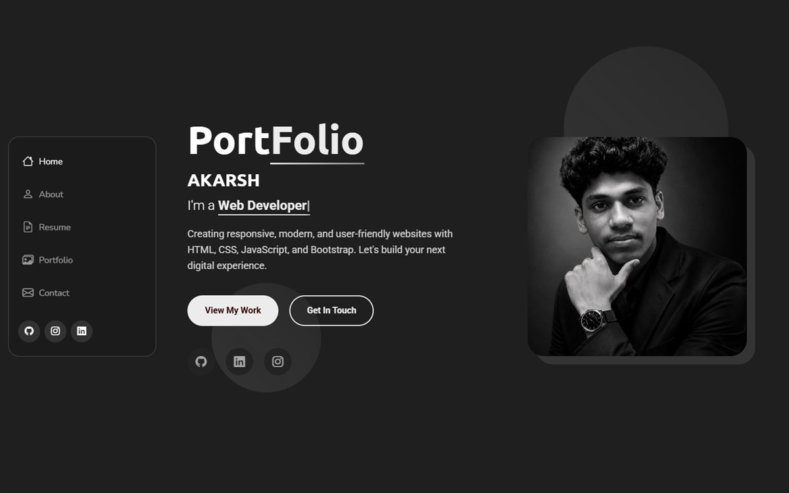

# Personal Portfolio

[](https://akarshkv1234-glitch.github.io/portfolio/)
[](https://developer.mozilla.org/docs/Web/HTML)
[](https://developer.mozilla.org/docs/Web/CSS)
[](https://developer.mozilla.org/docs/Web/JavaScript)
[](https://getbootstrap.com/)



My personal portfolio website, showcasing who I am, the technologies I work with,
my resume and selected projects.

**Live site:** https://akarshkv1234-glitch.github.io/portfolio/

## Sections

- About
- Skills
- Resume
- Projects
- Contact

## Features

- Responsive layout for desktop, tablet and mobile
- Animated hero section with a typed role switcher
- Skills, resume and project showcase
- Contact section with social links

## Built with

- HTML5
- CSS3
- JavaScript
- Bootstrap 5
- Bootstrap Icons

## Run locally

There is no build step. Open `index.html` in a browser, or serve the folder:

```bash
python -m http.server 8000
```

Then visit http://localhost:8000.

## Credits

Design based on the [SnapFolio](https://bootstrapmade.com/snapfolio-bootstrap-portfolio-template/)
template by [BootstrapMade](https://bootstrapmade.com/), customized with my own
content, styling and project details.
